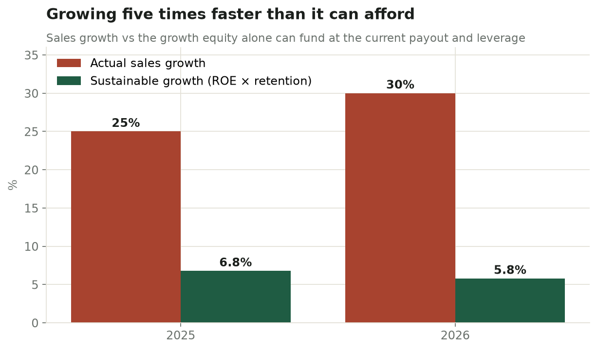
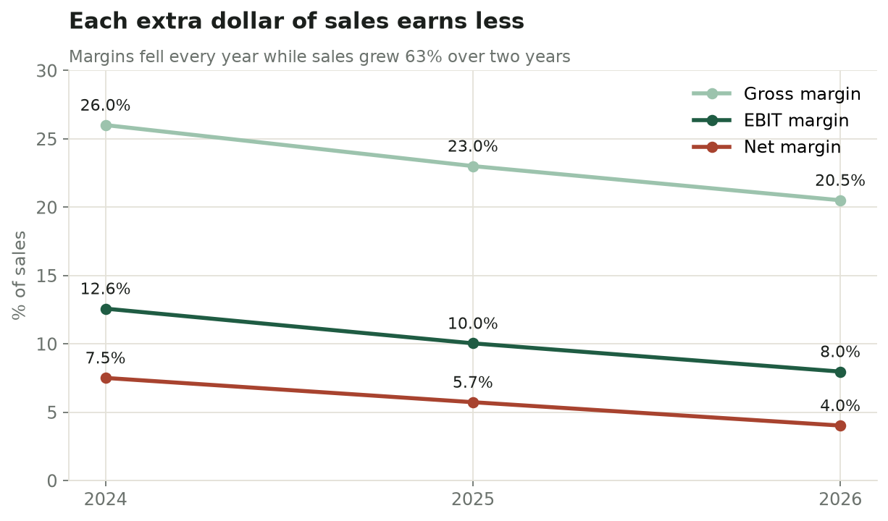
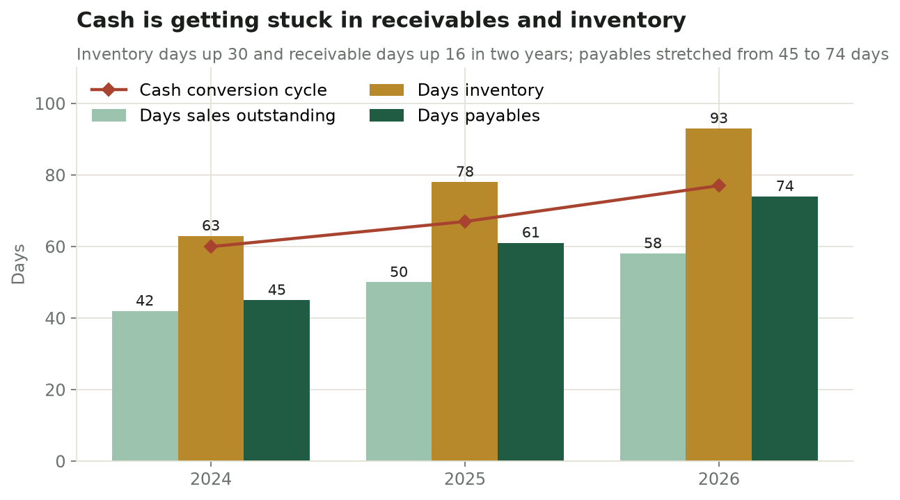
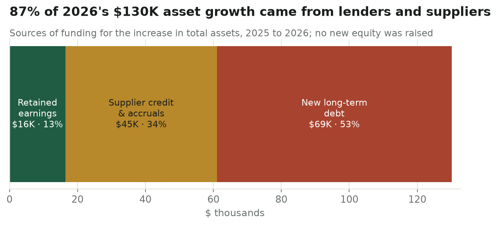
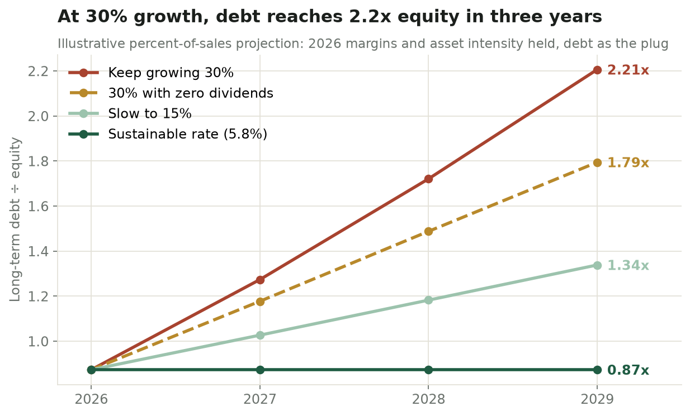

# Mountain Mining Co.: Growing Faster Than It Can Afford

**Sales are up 63% in two years. So why is cash down 71%, debt up 58% and net income falling?**

A financial diagnosis of a fast-growing company using ratio analysis, DuPont decomposition, Higgins' sustainable growth rate, working-capital days, a supplier-discount decision and a forward projection. The conclusion: Mountain Mining is growing about five times faster than its equity can support, and it is funding the gap with debt and unpaid suppliers.

> Financial Management (FIN-5417), Hult International Business School, November 2026. The financial statements are a course case provided by the instructor; the analysis, code and projection are mine. The Python model is checked against the class workbook by the tests.

---

## Key findings

| | |
|---|---|
| **Actual growth 30% vs sustainable 5.8%** | ROE of 9.6% × 60% retention supports about 6% growth a year without new equity or more leverage. |
| **Growth is getting less profitable** | Gross margin fell from 26.0% to 20.5% and net margin from 7.5% to 4.0%. Net income fell two years in a row. |
| **Cash is trapped in working capital** | Inventory days went from 63 to 93 and receivable days from 42 to 58. The cash conversion cycle grew from 60 to 77 days. |
| **87% of 2026's asset growth was borrowed** | $69K of new long-term debt and $45K of extra supplier credit, against $16K of retained earnings. Cash fell to $5,200. |
| **Skipping supplier discounts costs ~28% a year** | Paying on day 60 instead of taking 2% on day 30 costs 27.9% annually, against 7% for the company's debt. Forgone discounts were 29% of net income. |
| **At 30% growth, debt reaches 2.2x equity by 2029** | Even with zero dividends it reaches 1.8x. Growing at the sustainable rate holds it flat at 0.87x. |



## Diagnosis

### 1. Growth is outrunning equity

Sustainable growth, g\* = ROE × retention rate, is the fastest a company can grow while keeping its leverage and payout constant. DuPont shows why it is so low here:

| | 2025 | 2026 |
|---|---|---|
| Net margin | 5.7% | 4.0% |
| × Asset turnover (on opening assets) | 1.11 | 1.24 |
| × Equity multiplier (opening) | 1.78 | 1.94 |
| **= ROE** | **11.3%** | **9.6%** |
| × Retention (1 − 40% payout) | 60% | 60% |
| **= Sustainable growth** | **6.8%** | **5.8%** |
| Actual sales growth | 25% | 30% |

The only DuPont lever moving up is leverage. Asset turnover improved slightly, but the margin collapse more than offset it.



### 2. Working capital absorbs the cash



Inventory and receivables grew much faster than sales (+158% and +125% against +63% since 2024). The company is pushing that strain onto suppliers: year-end payables rose from 45 to 74 days of cost of goods sold.

### 3. Debt and suppliers fill the gap



| Liquidity and leverage | 2024 | 2025 | 2026 |
|---|---|---|---|
| Current ratio | 2.98 | 2.34 | 2.16 |
| Quick ratio | 1.69 | 1.14 | **0.98** |
| Long-term debt ÷ equity | 0.62 | 0.68 | **0.87** |
| Interest coverage (EBIT ÷ interest) | 4.9x | 4.2x | **3.1x** |

### 4. The supplier-discount decision

Suppliers offer **2/30 net 60**: a 2% discount for paying within 30 days, otherwise the full amount by day 60. Skipping the discount means paying 2% to borrow for 30 extra days:

> (1 + 2/98)^(365/30) − 1 = **27.9% effective annual cost** (20.9% after tax), against a 7% cost of debt.

Forgone discounts in 2025 were about **$8,700, or 29% of net income**. Borrowing at 7% to pay on day 30 would have added roughly $4,700 to after-tax profit. **Take the discount.**

### 5. What happens if growth continues



An illustrative percent-of-sales projection holds 2026 margins, asset intensity and payout constant, with long-term debt as the plug:

| Path to 2029 | Debt ÷ equity | Interest coverage |
|---|---|---|
| Keep growing 30% | 2.21x | 2.2x |
| 30% with zero dividends | 1.79x | 2.3x |
| Slow to 15% | 1.34x | 2.2x |
| Sustainable rate (5.8%) | 0.87x (unchanged) | 2.4x |

Even eliminating the dividend cannot fund 30% growth. Holding leverage constant at 30% growth would need an ROE of 50% at the current payout (30% with no dividends at all), against 9.6% today.

## Recommendations

1. **Slow growth toward the sustainable rate** until margins recover. The newest sales appear to be the least profitable ones.
2. **Take the 2% supplier discount**, funded by the credit line. It is the cheapest profit improvement available.
3. **Release working capital:** tighten credit terms and inventory policy back toward 2024 levels (42 receivable days, 63 inventory days).
4. **If growth is strategic, fund it with equity**, not more debt. Coverage near 2x leaves little room for a downturn in a cyclical industry.

## Repository

```
data/mountain_mining.csv    income statement and balance sheet, 2024–2026 (course case)
src/model.py                ratios, DuPont, sustainable growth, trade credit, funding, projection
src/make_charts.py          builds charts/*.png and results.json
tests/test_model.py         checks the Python model against the class workbook
```

```bash
python3 -m pip install -r requirements.txt
python3 src/make_charts.py
python3 -m unittest -v tests/test_model.py
```

## Limits

- Three years of statements from a teaching case; no industry benchmarks or market data.
- The projection is mechanical: it holds 2026 ratios constant and does not model price, mix or capacity changes.
- Year-end balances are used for working-capital days, which overstates them in a fast-growing year compared with averages.

## Reference

Higgins, R. C. "How Much Growth Can a Firm Afford?" *Financial Management*, 6(3), 1977.

---

**Vikram Manisankar** · [Portfolio](https://vikrammanisankar26-cpu.github.io) · [LinkedIn](https://www.linkedin.com/in/vikram-manisankar)
